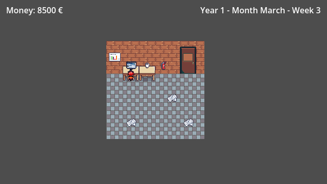

# I Want To Be A Game Dev

**Projet d'apprentissage Godot 4.7** : un clone simplifié de *Game Dev Tycoon*.
C'est un prototype, pas un jeu distribué : il se lance depuis l'éditeur Godot (F5), il n'y a pas encore de build exporté.

*Capture réelle du prototype lancé avec Godot 4.7.2 (640×360, résolution interne).*

## Intention

Ce jeu est volontairement un clone simplifié de Game Dev Tycoon.
Il a pour but l'apprentissage de Godot : scènes, signaux, machine à états, données séparées du code.

## Boucle de jeu

1. Clic droit n'importe où dans la scène → menu d'actions (met le temps en pause).
2. Créer un nouveau jeu : nom, genre, thème, plateforme. Le coût du projet est déduit au lancement.
3. Le développement s'écoule sur un nombre fixe de semaines.
4. À la sortie : modale avec note + critique + revenus versés en une fois.
5. Le jeu terminé rejoint l'historique. Les coûts fixes du studio sont déduits chaque mois.
6. Si l'argent tombe à zéro → modale de faillite, fin de partie.

## Limites connues

- Après une faillite pendant un projet, **« Retry » peut laisser le bouton de création désactivé** (soft-lock) : le bouton n'est réactivé qu'à la sortie d'un jeu, pas par `reset_game()`.
- Pas de condition de victoire : seule la faillite termine la partie.
- Pas de sauvegarde.
- `music_loop.wav` n'est pas compressé (23 Mo).
- Crédits graphiques incomplets ; `pay.wav` n'est pas encore crédité.

## Lancer le projet

Version vérifiée : **Godot 4.7** (`config/features=PackedStringArray("4.7", "Forward Plus")`
dans `project.godot`) ; la capture ci-dessus a été produite avec Godot 4.7.2.

1. Ouvrir Godot, puis « Importer » et sélectionner le fichier `project.godot`.
2. Laisser l'éditeur terminer l'importation des ressources au premier lancement.
3. Appuyer sur ▶ ou F5 : le jeu démarre directement sur l'écran principal.

L'export en exécutable n'est pas configuré ; il n'y a ni build web ni build desktop.

## Crédits — Audio

Les assets sonores listés ci-dessous sont sous licence libre d'usage commercial avec attribution.

| Fichier | Auteur | Source | Licence |
|---------|--------|--------|---------|
| `Assets/audio/music_loop.wav` | edwinnington | [A Theme — OpenGameArt](https://opengameart.org/content/a-theme) | [CC-BY 3.0](https://creativecommons.org/licenses/by/3.0/) |
| `Assets/audio/cash_machine.wav` | atha89 | [Opening Cash Register — Freesound](https://freesound.org/s/79063/) | [Attribution 3.0](https://creativecommons.org/licenses/by/3.0/) |
| `Assets/audio/click.wav` | EdgardEdition | [Click3 — Freesound](https://freesound.org/s/113093/) | [Attribution 3.0](https://creativecommons.org/licenses/by/3.0/) |
| `Assets/audio/pay.wav` | à compléter | à compléter | à compléter |

Les fichiers texte de licence détaillés se trouvent dans `Assets/audio/licences/`.
Les crédits des graphismes restent à compléter avant toute diffusion.

## Licence

MIT — voir [LICENSE](LICENSE). Les crédits audio et leurs licences respectives
sont détaillés ci-dessus.
